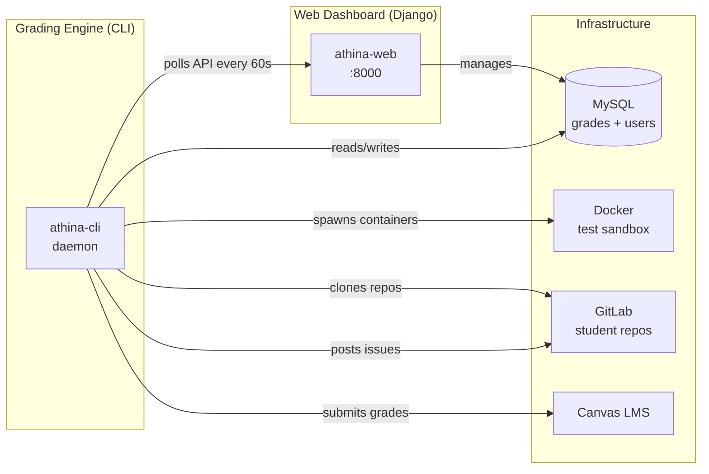

# Athina — Automated Grading Platform

[](https://athina.semaphoreci.com/projects/athina)
[](https://opensource.org/licenses/MIT)

**Code Quality Metrics (SonarCloud):**

[](https://sonarcloud.io/summary/new_code?id=athina-edu_athina)
[](https://sonarcloud.io/summary/new_code?id=athina-edu_athina)
[](https://sonarcloud.io/summary/new_code?id=athina-edu_athina)
[](https://sonarcloud.io/summary/new_code?id=athina-edu_athina)
[](https://sonarcloud.io/summary/new_code?id=athina-edu_athina)
[](https://sonarcloud.io/summary/new_code?id=athina-edu_athina)
[](https://sonarcloud.io/summary/new_code?id=athina-edu_athina)
[](https://sonarcloud.io/summary/new_code?id=athina-edu_athina)
[](https://sonarcloud.io/summary/new_code?id=athina-edu_athina)
[](https://sonarcloud.io/summary/new_code?id=athina-edu_athina)
[](https://sonarcloud.io/summary/new_code?id=athina-edu_athina)

Athina is an automated grading platform for programming assignments. It includes a CLI grading engine and a built-in web dashboard for managing courses, assignments, and students.

Need plug-and-play assignments and tests? Check out [Athina Assignments](https://github.com/athina-edu/athina-assignments).

## Quick Start

### Docker Compose (Recommended)

```bash
git clone https://github.com/athina-edu/athina.git
cd athina
docker compose up
```

- **Web dashboard**: http://localhost:8000
- **Grading engine**: runs automatically, polling the web API

### From Source

```bash
git clone https://github.com/athina-edu/athina.git
cd athina

# CLI only
pip install .

# CLI + Web Dashboard
pip install ".[web]"

# Start the web dashboard
python manage.py migrate
python manage.py runserver 0.0.0.0:8000

# Start the grading daemon (separate terminal)
athina-cli --json http://localhost:8000/assignments/api/ -s -v
```

### One-Click Install (Production)

Uses the [athina-one-click-run](https://github.com/athina-edu/athina-one-click-run) bundle for a full production deployment with nginx, MySQL, and SSL.

```bash
git clone https://github.com/athina-edu/athina-one-click-run.git
cd athina-one-click-run
sudo ./run.sh
```

## Architecture



### Components

| Component | Description |
|-----------|-------------|
| **`athina-cli`** | Grading daemon — clones repos, runs tests in Docker, computes grades |
| **`athina_web`** | Django web dashboard — manages courses, assignments, students, displays results |
| **MySQL** | Stores grades, student data, LLM feedback, plagiarism scores |
| **Docker** | Sandboxes student code execution with memory/network limits |

## Features

- **Multi-language testing** — C, C++, Bash, Java, Python, Ruby, R, and more
- **Docker sandboxing** — student code runs in isolated containers with configurable limits
- **AI-powered feedback** — LLM integration via any OpenAI-compatible endpoint (GPT-4, Claude, MiMo, etc.)
- **GitLab Issues output** — grades posted as issues in each student's own repository
- **Canvas LMS integration** — submit grades and comments directly to Canvas
- **Plagiarism detection** — built-in copydetect with similarity scoring
- **Web dashboard** — manage courses, enroll students, view reports, force re-runs
- **Group assignments** — shared repositories with configurable member limits
- **GitLab webhook support** — immediate re-grading when students push new commits
- **Per-test scoring and overrides** — tests can report individual pass/fail results, which faculty and TAs can adjust with notes and re-post
- **Due dates** — per-assignment deadlines, set from the web UI, enforced against the commit date
- **Timezone-aware dates** — timestamps render in the viewer's timezone (browser or profile setting)
- **Student repo provisioning** — auto-create GitLab repos for students

## How grading works

1. The daemon is notified of a change — a **GitLab push webhook** (preferred) or its
   periodic poll, which still runs as a safety net (`webhook_fallback_interval`).
2. The student's repo is pulled and the newest commit date is compared with the
   assignment's due date. Commits after the deadline are not graded.
3. Each `test_scripts` entry runs in its own Docker container. The **last numeric
   line** of a script's stdout is its score (0–100).
4. Scores are combined using `test_weights` and scaled by `total_points`.
5. An LLM (if enabled) writes feedback, and the grade plus report are submitted to
   the configured output: a GitLab issue in the student's repo, or Canvas.

### Reporting individual tests

A test script can report finer-grained results than one number, so the dashboard
can show (and an instructor can correct) each test separately. Two notations are
understood:

```bash
# Simplest: echo a marker next to your existing PASS/FAIL output.
echo "#ATHINA# PASS | q1.sql: output matches instructor"
echo "#ATHINA# FAIL | q2.sql: output matches instructor"
```

```bash
# Richer: source the helper and declare tests with names, weights and details.
. athina-test.sh
athina_test_begin "q1" "List Elvis's employees" weight=0.8
athina_test_pass "q1"            # or: athina_test_fail "q1" "why"
athina_test_score "q1" 85        # optional partial credit
athina_test_end                  # prints the total Athina parses
```

Markers may be printed on stdout; the helper writes to stderr. Either way they are
kept out of the output files used for comparison, so graded results are unaffected.
Scripts that use neither notation are unaffected — Athina records one result per
test script instead.

### Reviewing and overriding scores

Each student row in the dashboard has an **Adjust** button. It lists every reported
test with its score, pass/fail state and detail, and lets faculty or TAs:

- override an individual test's score (cleared to fall back to the reported value),
- add a note that is shown with that test,
- save, recomputing the weighted grade, and
- **re-post** the result to the student through the assignment's output method
  (updates the existing GitLab issue when one exists).

Overrides are keyed by test, so they **survive a re-run**: a later automatic grading
pass refreshes the reported scores without discarding an instructor's correction.

## Configuration

### Assignment Setup

Each assignment needs an `athina.yaml` in its git template repo:

```yaml
input_method: db                    # 'canvas' or 'db'
output_method: gitlab_issues        # 'gitlab_issues' (default) or 'canvas'
test_scripts:
  - bash test-correctness.sh
  - bash test-efficiency.sh
test_weights: [0.8, 0.2]
total_points: 100
enforce_due_date: true              # deadline is set in the web UI (stored as UTC)
test_timeout: 300
use_webhook: true                   # grade immediately on push
webhook_fallback_interval: 3600     # ...but still poll each repo hourly (0 = off)
llm_enabled: true
```

### Due dates

Set an assignment's deadline from **Edit Assignment → Due date**. The value is
entered in your display timezone (see the profile page) and stored as UTC for the
grading engine. Leaving the field blank removes the deadline. The assignment page
shows the current deadline; a committed change after it is not graded.

### Timezones

Grading timestamps are stored as UTC. The web UI renders them in the viewer's
timezone: choose **Automatic** in your profile to follow the browser, or pick an
explicit zone. This affects every date shown, including the last graded commit.

### Faculty Profile (Web Dashboard)

Set credentials in the web dashboard (Profile page):

- **GitLab/GitHub** — access tokens for cloning student repos
- **LLM API** — OpenAI-compatible endpoint for AI feedback
- **Output mode** — Canvas or GitLab Issues (per assignment)

Credentials are stored in `.env` files in each assignment directory, written automatically by the web app.

### Environment Variables

| Variable | Default | Description |
|----------|---------|-------------|
| `ATHINA_MYSQL_HOST` | `localhost` | Grading database host |
| `ATHINA_MYSQL_PORT` | `3306` | Grading database port |
| `ATHINA_MYSQL_USERNAME` | `athina` | Grading database user |
| `ATHINA_MYSQL_PASSWORD` | — | Grading database password |
| `ATHINA_WEB_URL` | — | Public URL of the dashboard; the GitLab webhook URL is built from it. **Must be a single origin** (e.g. `https://athina.example.edu`) |
| `DOCKER_MEMORY_LIMIT` | `2g` | Memory cap per test container |
| `GLOBAL_MEMORY_LIMIT` | `80` | Host memory % above which new grading waits |
| `ATHINA_TRIGGER_FILE` | `/code/athina_files/.webhook_trigger` | Where the web app signals the daemon to run a pass immediately (local dev override) |

### Webhooks

With `use_webhook: true`, a GitLab push event writes `webhook_event` on that
student, and the web app signals the daemon to run a pass at once instead of waiting
for the next poll — typically seconds of latency instead of up to a minute. The
handler is at `/assignments/webhook/` and authenticates requests by matching a
random per-student token (`X-Gitlab-Token`) against the database, so it is safe to
expose without session auth.

`webhook_fallback_interval` keeps a periodic poll so a missed or blocked delivery
cannot leave a student ungraded. Set it to `0` to rely solely on webhooks.

## CLI Reference

### Flags

| Flag | Description |
|------|-------------|
| `-c, --config` | Path to YAML config file or directory |
| `-j, --json` | URL to web API for assignment list |
| `-r, --repo_url_testing` | Test a single repo URL |
| `-v, --verbose` | Verbose console output |
| `-s, --service` | Daemon mode (polls every 60s) |

### Service Mode

```bash
athina-cli --json http://localhost:8000/assignments/api/ -s -v
```

The daemon polls the web API every 60 seconds, pulls the latest assignment config from git, detects new student commits, and runs tests.

### Single-Pass Mode

```bash
athina-cli --config /path/to/config/ --verbose
```

## Web Dashboard

The web dashboard (`athina_web`) provides:

- **Course management** — create courses, enroll students via email or bulk import
- **Assignment management** — create from Git template repos, configure grading options
- **Due dates** — set a per-assignment deadline; stored as UTC, entered in your timezone
- **Student view** — grades, test reports, plagiarism reports per student, the commit that was graded, and the repo link
- **Per-test breakdown** — each reported test with its score and pass/fail state
- **Score adjustment** — faculty and TAs can override individual test scores, add notes, and re-post the result (GitLab issue or Canvas)
- **AI Guidance** — view LLM-generated feedback for each student
- **Force Rerun** — re-grade one student immediately (without waiting for the poll)
- **File browser** — browse and edit assignment files
- **Faculty profiles** — manage Git/LLM credentials and display timezone per instructor
- **Role-based access** — Admin, Faculty, and Teaching Assistant roles

### Running Locally

```bash
pip install ".[web]"
python manage.py migrate
python manage.py createsuperuser
python manage.py runserver 0.0.0.0:8000
```

## Development

### Prerequisites

- Python 3.11+
- Docker (for test sandboxing)
- MySQL (for production) or SQLite (for development)

### Running Tests

```bash
# Quick run (excludes slow tests)
pytest -m "not slow"

# Full suite
pytest

# With coverage
pytest --cov=athina --cov-report=html

# Convenience wrapper with the same options
./run_tests.sh            # -d for Docker MySQL, -c for coverage, -v for verbose
```

### Project Structure

```
athina/
├── athina/                  # Core grading engine (Python package)
│   ├── cli.py               # CLI entry point (daemon loop, trigger-file wake)
│   ├── configuration.py     # YAML config + .env loader
│   ├── test_report.py       # Parses per-test results (#ATHINA# markers / helper)
│   ├── test_helpers/        # athina-test.sh: helper for declarative test results
│   ├── tester/              # Test orchestration, Docker sandboxing
│   ├── git/                 # Git repo management (Chain of Responsibility)
│   ├── users.py             # Peewee ORM models (MySQL/SQLite), incl. TestResult
│   ├── canvas.py            # Canvas LMS API
│   ├── gitlab_issues.py     # GitLab issue integration
│   ├── llm.py               # LLM feedback generation
│   ├── plagiarism.py        # Plagiarism detection
│   └── moss.py              # Plagiarism detection (CopyDetect; name is historical)
├── athina_web/              # Django web dashboard
│   ├── accounts/            # Users, roles, profile (credentials, timezone)
│   ├── assignments/         # Courses/assignments, reports, score overrides
│   ├── filemanager/         # In-browser file browser
│   ├── templates/           # HTML templates
│   └── static/              # CSS, JS
├── tests/                   # Test suite
├── config-examples/         # Example configs and test scripts
├── Dockerfile               # CLI image
├── Dockerfile.web           # Web dashboard image
├── docker-compose.yml       # Development compose
├── setup.py                 # Package definition
└── manage.py                # Django management
```

## Security

- **Sandboxed execution** — all student code runs in Docker containers
- **Network isolation** — containers have configurable network access
- **Memory limits** — prevents resource exhaustion
- **Test timeouts** — kills infinite loops after configurable period
- **Credential isolation** — Git/LLM tokens stored in `.env` files, never in student-accessible paths
- **Git domain restriction** — authentication only under configured domain

## License

MIT — see [LICENCE](LICENCE) for details.

## Video Tutorial

[How to configure and build tests](https://youtu.be/TAYRRYnk3NQ)
